# FuelLog 4 — учёт техники, расход и запасы ГСМ

FuelLog рассчитывает потребность в горюче-смазочных материалах (АБ и ДТ) для задач, которые выполняет техника
подразделений, и формирует отчёт в Excel по установленной форме: расход в килограммах и заправках, масса заправки,
среднесуточный расход — с итогами по подразделениям, воинским частям и в целом.

В комплекте две связанные программы:

| Программа | Что делает |
|---|---|
| **FuelLog** (модель 1) | Справочник техники, структура подразделений, задачи по датам → расход ГСМ и отчёт по форме |
| **Потребность и автономность** (модель 2) | Документ по суткам для рд: установленные запасы, остаток, приход, расход, потери, наличие, потребность и автономность. Технику и расход на задачи берёт из проектов FuelLog |

Обе программы работают **полностью автономно**: без сети, без базы данных, каждый документ — один файл.
Рассчитаны на ПК под Secret Net.

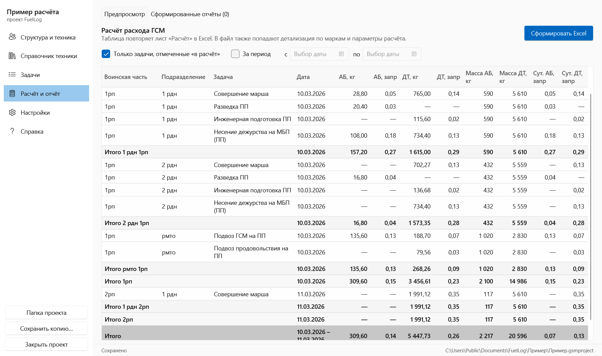

## Скачать

Последняя версия — на странице **[Releases](https://github.com/GanJaGIT/fuel-logger3/releases/latest)**:

| Файл | Что это |
|---|---|
| `FuelLog_4.2.0_Setup.exe` | Установщик обеих программ: ярлыки, открытие файлов двойным щелчком |
| `FuelLog_4.2.0_portable.zip` | Переносная версия: распаковать и запустить `FuelLog.exe` или `FuelLogSupply.exe` |

Требования: Windows 10/11 x64. Устанавливать .NET не нужно.

## Как начать работу

1. **Установите** программу или распакуйте переносную версию.
2. **Запустите FuelLog** и нажмите **«Открыть пример»**: откроется готовый проект с техникой и задачами.
   Пройдите по вкладкам слева, чтобы увидеть, как всё устроено.
3. **Создайте свой проект** («Закрыть проект» → «Создать проект») и заполните его по порядку:
   - **Справочник техники** — марки, топливо, баки, нормы расхода на 100 км и на час работы;
   - **Структура и техника** — воинские части (рп), подразделения и закреплённая за ними техника;
   - **Задачи** — дата, название и техника подразделений с километрами марша, часами работы и % потерь;
   - **Расчёт и отчёт** — проверьте предпросмотр и нажмите **«Сформировать Excel»**.
4. Сохранять ничего не нужно: изменения записываются автоматически, последние 10 версий файла
   хранятся в папке «Резервные копии».

Подробно о каждой вкладке, методике, переносе данных и решении проблем —
в **[руководстве пользователя FuelLog](docs/USER_GUIDE.md)**. Краткая справка есть и в самой программе (F1).

### Потребность и автономность (модель 2)

1. Запустите **«Потребность и автономность»** и нажмите **«Открыть пример»** — пример рд (управление, 1 рп, трб)
   вместе со связанным проектом FuelLog и тремя сутками.
2. Свой документ: **«Создать документ»** → привяжите проект FuelLog — структура построится по его частям и подразделениям.
3. Проверьте **«Структуру и нормы»** (склады, БМТО/РМТО, установленные запасы по приказу №074),
   заполните **«Наличие запасов»** (склады — по книгам учёта) и **«Транспорт подвоза»**.
4. Каждый день на экране **«Сутки»**: дозаправка ВВСТ, подвоз, загрузка в транспорт, потери — и **«Сформировать Excel»**
   (вкладки ДТ и АБ по форме и лист операций).

Подробно — в **[руководстве по «Потребности и автономности»](docs/SUPPLY_GUIDE.md)**.

## Возможности

| | |
|---|---|
| 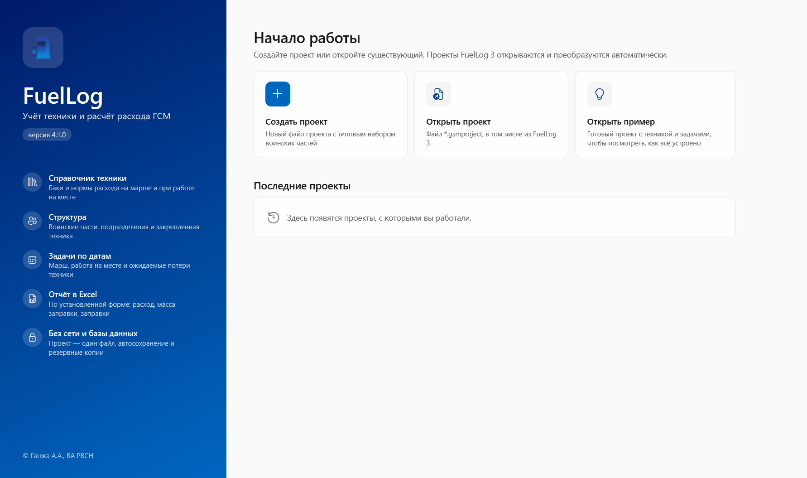 | **Стартовое окно** — создание и открытие проектов, последние проекты, демонстрационный пример. |
| 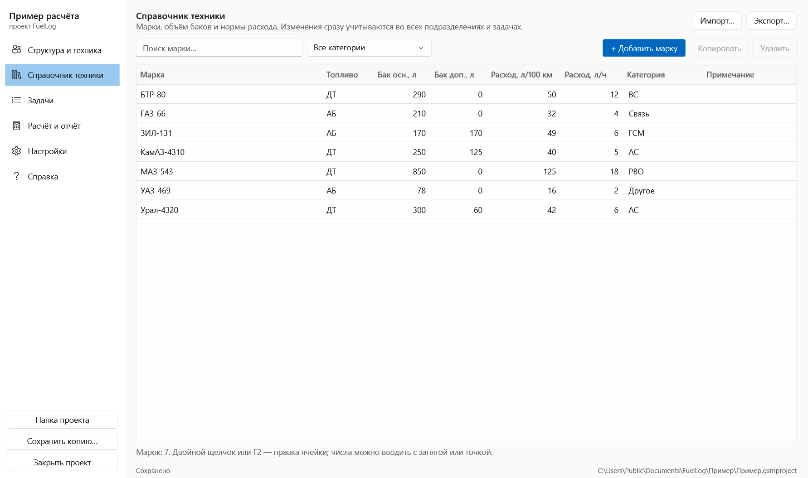 | **Справочник техники** — марки, вид топлива, основной и дополнительный баки, нормы расхода, категории. Поиск и фильтр, импорт и экспорт для переноса между ПК (подходят и файлы FuelLog 3). |
| 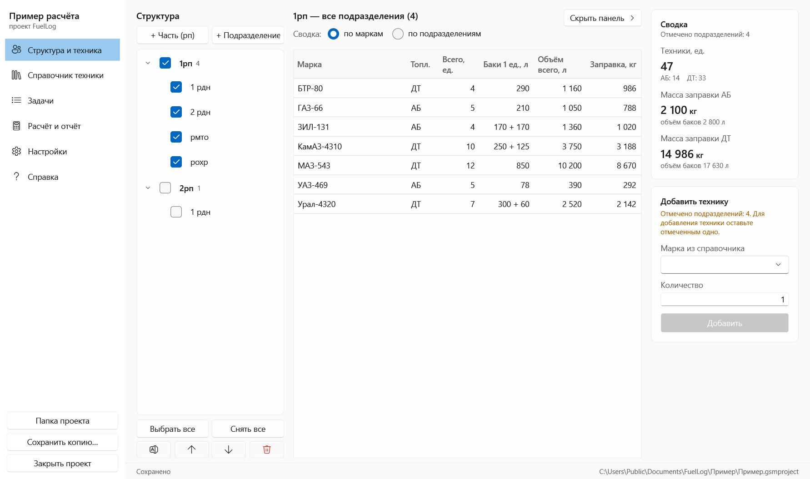 | **Структура и техника** — воинские части → подразделения → техника. Подразделения отмечаются галочками (одно, несколько, вся в/ч, «Выбрать все»), для нескольких — сводка по маркам или по подразделениям. Правая панель скрывается. |
| 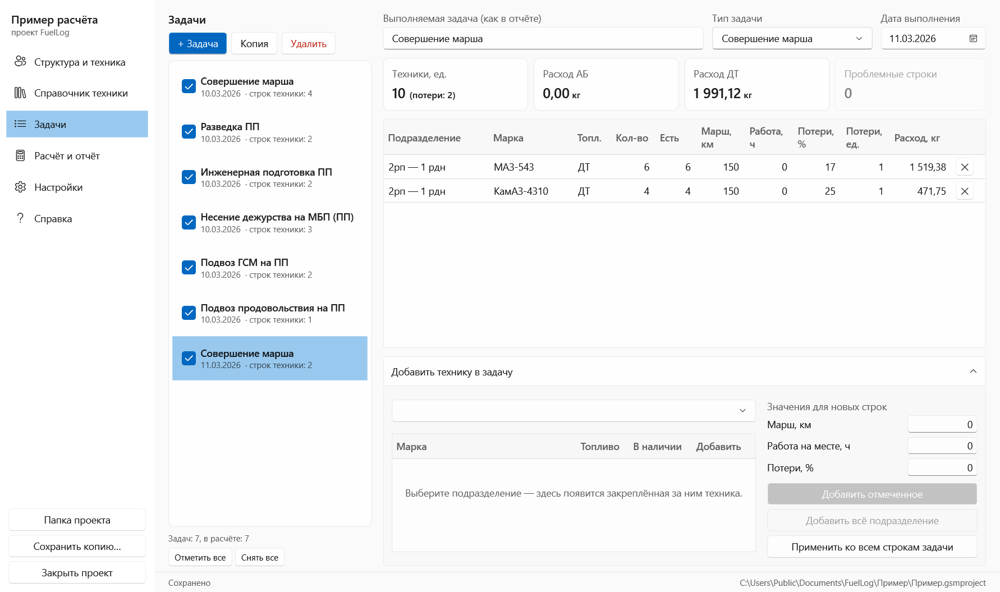 | **Задачи** — по датам, с копированием. Техника добавляется из подразделений, расход считается сразу, превышение наличия подсвечивается. |
|  | **Расчёт и отчёт** — предпросмотр, отбор по периоду, Excel из трёх листов: «Расчёт» (форма), «Детализация» (по маркам), «Параметры» (методика). |
| 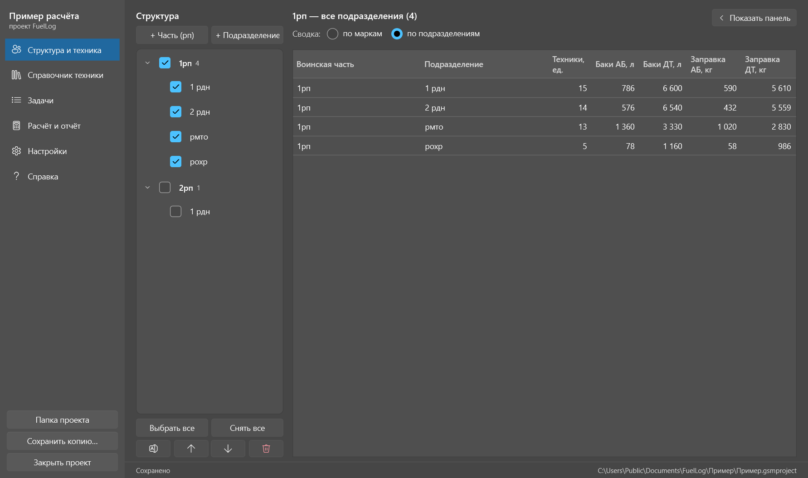 | **Оформление** — светлая, серая и тёмная темы; русские форматы чисел и дат. |

**Потребность и автономность:**

| | |
|---|---|
| 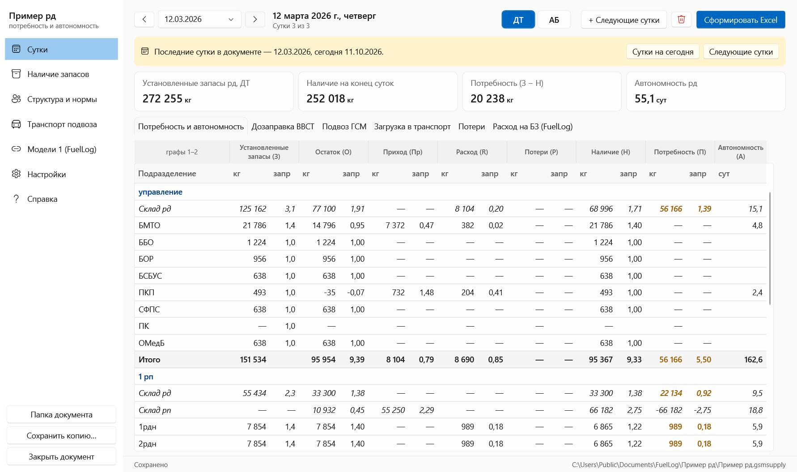 | **Сутки** — документ «Потребность и автономность» по форме (17 граф), ДТ и АБ, итоги по частям и рд, переход между сутками, остаток = наличие предыдущих суток. |
| 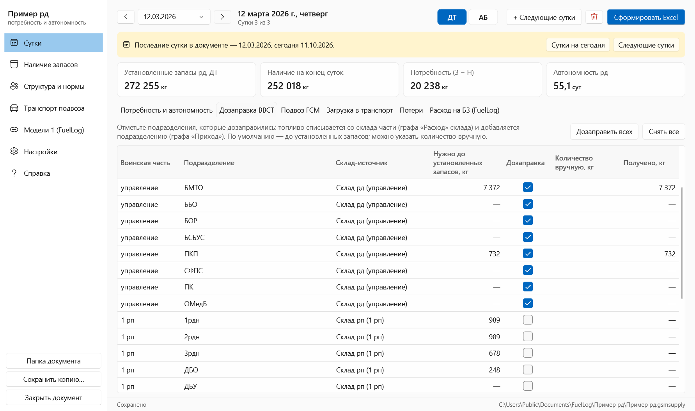 | **Операции** — дозаправка ВВСТ со склада части, подвоз (склад рд ↔ склады частей), потери, расход на БЗ из FuelLog. |
| 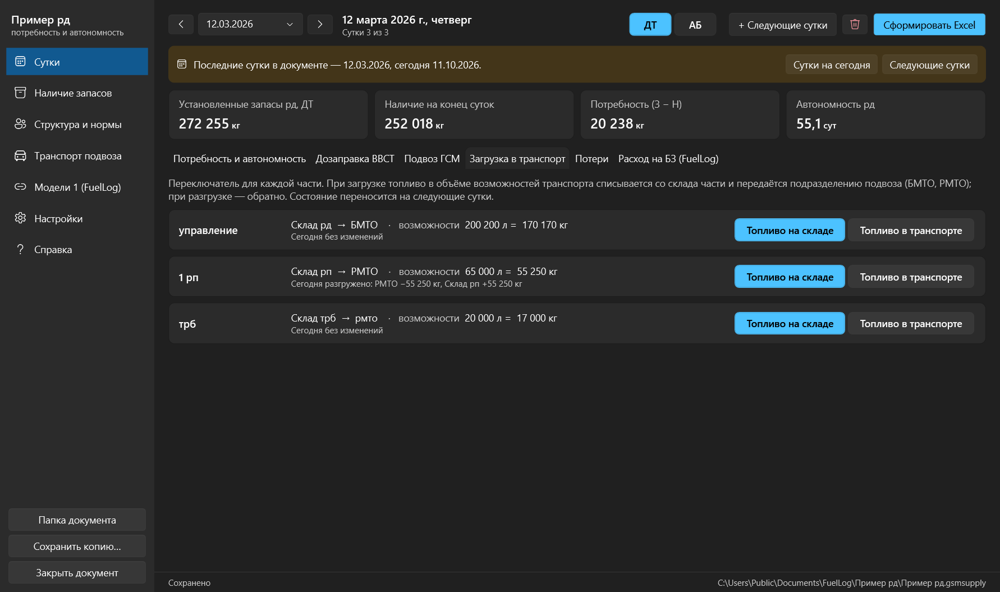 | **Загрузка в транспорт** — склад части ↔ БМТО/РМТО на объём возможностей транспорта одним переключателем. |
| 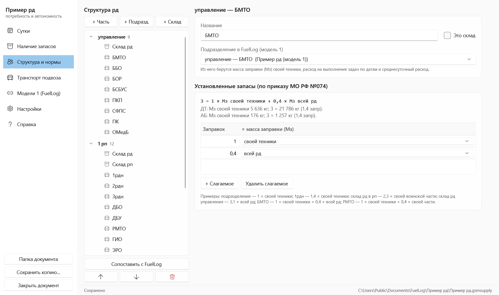 | **Структура и нормы** — склады и подразделения, привязка к FuelLog, установленные запасы слагаемыми (своя техника, часть, рд). |
| 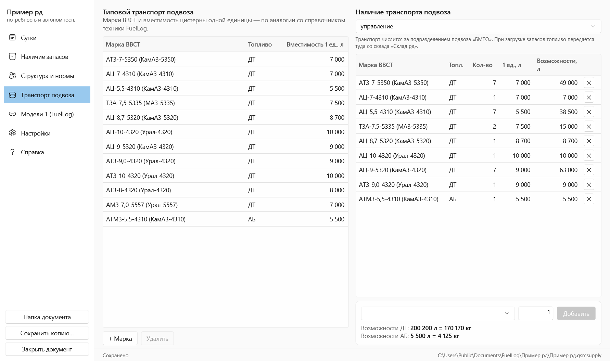 | **Транспорт подвоза** — типовые марки и вместимость, наличие у частей, возможности в литрах и кг. |
| 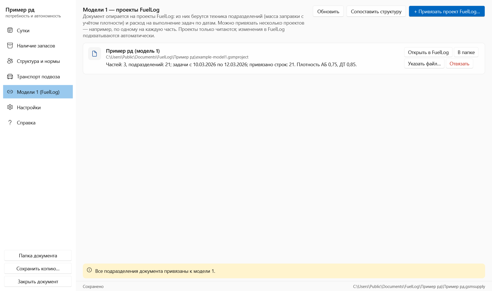 | **Модели 1** — привязка одного или нескольких проектов FuelLog, сопоставление структуры по названиям. |

## Методика расчёта

| Величина | Формула |
|---|---|
| Потеряно, ед. | `кол-во × потери % / 100`, округление до целого (0,5 — вверх) |
| Расход, л | `работающие × (км / 100 × норма л/100 км + ч × норма л/ч) + потерянные × (бак осн. + бак доп.)` |
| Расход, кг | `литры × плотность` (АБ/ДТ задаются в настройках проекта) |
| Масса заправки | `Σ кол-во × (бак осн. + бак доп.) × плотность` по всей технике подразделения / воинской части / итога |
| Заправки | `кг / масса заправки` соответствующего уровня |
| Среднесуточный расход | `заправки / число дней` выполнения задач |

Расчёт сверен с образцом формы отчёта автоматическим тестом (`ReportTests.Reproduces_sample_rows_and_refills`).
Пример расчёта на цифрах — в [руководстве](docs/USER_GUIDE.md#9-методика-расчёта).

## Данные и безопасность

- Проект — один файл `*.gsmproject` (JSON, UTF-8). Рядом создаются папки «Отчёты» и «Резервные копии».
- Запись атомарная (временный файл → замена), поэтому сбой питания не повреждает проект.
- Программа не обращается к сети и не распаковывает файлы во временные папки. Для замкнутой программной среды
  Secret Net достаточно разрешить `FuelLog.exe` и библиотеки `*.dll` из папки программы.
- Настройки программы: `%APPDATA%\FuelLog\settings.json`, журнал ошибок: `%APPDATA%\FuelLog\errors.log`.
- Проекты FuelLog 3 открываются и конвертируются автоматически, оригинал сохраняется как `*.gsmproject.v3.bak`.

## Для разработчиков

Стек: .NET 10, WPF (тема Fluent), CommunityToolkit.Mvvm, ClosedXML, xUnit.

```
src/FuelLog.Core            модель 1: модель, расчёт, хранение, импорт FuelLog 3, Excel (без WPF)
src/FuelLog.Supply.Core     модель 2: структура, нормы, расчёт по суткам, связь с моделью 1, Excel (без WPF)
src/FuelLog.Ui              общее оформление, темы, диалоги, автосохранение
src/FuelLog.App             FuelLog (WPF, MVVM)
src/FuelLog.Supply          «Потребность и автономность» (WPF, MVVM)
tests/FuelLog.Tests         тесты модели 1
tests/FuelLog.Supply.Tests  тесты модели 2 (нормы, сутки, операции, связь, Excel)
tests/FuelLog.App.Tests     тесты логики экранов обеих программ
installer/FuelLog.iss       установщик обеих программ (Inno Setup 6)
samples/                    демонстрационные примеры (входят в поставку)
tools/                      генераторы примеров (make-demo.cs, make-demo-supply.cs)
docs/                       руководства пользователя, ревью версии 3.x, план
```

Запуск тестов:

```bash
dotnet test FuelLog.slnx
```

Полная сборка: тесты, публикация в `publish/`, установщик и переносной архив в `dist/` (нужен Inno Setup 6).

```bash
powershell -ExecutionPolicy Bypass -File build.ps1
```

Проверка вёрстки без ручного запуска — снимки всех вкладок в PNG:

```bash
FuelLog.exe --snapshots <проект.gsmproject | -> <папка> [light|gray|dark]
FuelLogSupply.exe --snapshots <документ.gsmsupply | -> <папка> [light|gray|dark]
```

## Автор

© 2026 Ганжа А.А., ВА РВСН
