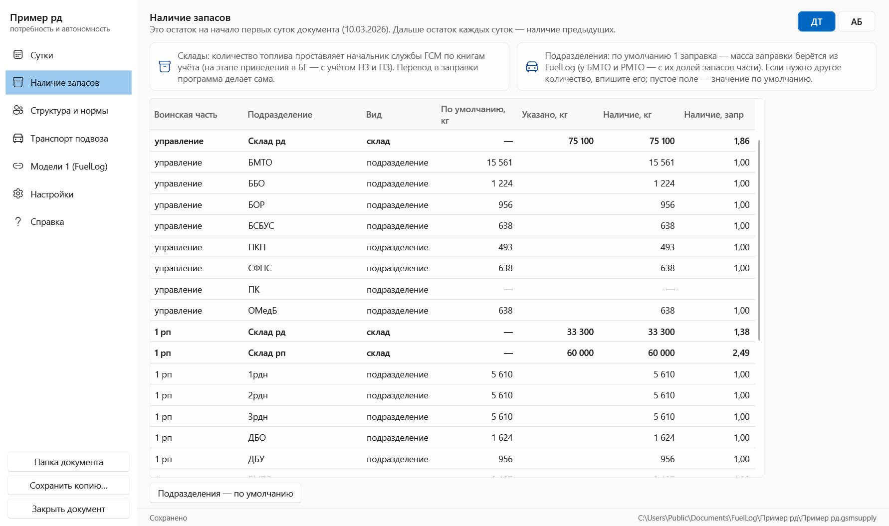

# Руководство: «Потребность и автономность» (модель 2)

Программа ведёт по суткам документ **«Потребность и автономность»** по запасам ГСМ рд: установленные запасы,
остаток, приход, расход, потери, наличие, потребность и автономность. Документ ведётся отдельно для ДТ и АБ.

Она работает в паре с **FuelLog (модель 1)**. Из проектов FuelLog берутся техника подразделений
(масса заправки с учётом плотности) и расход на выполнение задач по датам. Сами проекты FuelLog не изменяются.

**Содержание**

1. [Установка и первый запуск](#1-установка-и-первый-запуск)
2. [Модели 1: привязка проектов FuelLog](#2-модели-1-привязка-проектов-fuellog)
3. [Структура и нормы](#3-структура-и-нормы)
4. [Транспорт подвоза](#4-транспорт-подвоза)
5. [Наличие запасов](#5-наличие-запасов)
6. [Сутки: документ и операции](#6-сутки-документ-и-операции)
7. [Методика расчёта](#7-методика-расчёта)
8. [Хранение данных](#8-хранение-данных)
9. [Вопросы и решение проблем](#9-вопросы-и-решение-проблем)

---

## 1. Установка и первый запуск

Программа устанавливается вместе с FuelLog тем же установщиком или лежит в той же переносной папке:
`FuelLogSupply.exe` рядом с `FuelLog.exe`. В меню «Пуск» она называется **«Потребность и автономность»**.

- **Открыть пример** — демонстрационная рд (управление, 1 рп, трб) вместе со связанным проектом FuelLog и тремя сутками.
  Пример копируется в `Документы\FuelLog\Пример рд`.
- **Создать документ** — программа предложит сразу привязать проект FuelLog и построит структуру по его частям
  и подразделениям. Если отказаться, будет создана типовая структура: управление, 1–4 рп, трб.
- **Открыть документ** — файл `*.gsmsupply`.

При открытии документа программа проверяет дату. Если последние сутки в документе раньше сегодняшнего дня,
появляется плашка с кнопками «Сутки на сегодня» и «Следующие сутки».

---

## 2. Модели 1: привязка проектов FuelLog

- **+ Привязать проект FuelLog…** — выбор файла `*.gsmproject`. Можно привязать несколько проектов,
  например отдельный на каждую часть.
- **Сопоставить структуру** — строки документа привязываются к подразделениям FuelLog по названиям.
  Регистр и пробелы не важны: «1 рдн» = «1рдн». Недостающие части создаются по типовой структуре,
  недостающие подразделения добавляются. Уже привязанные строки не меняются.
- **Открыть в FuelLog** — открывает проект в FuelLog, чтобы поправить технику или задачи. После сохранения
  в FuelLog документ пересчитается сам при переходе между вкладками или по кнопке **«Обновить»**.
- **Указать файл…** — если проект перенесли в другое место.
- **Отвязать** — снимает привязку у строк; сами строки и данные суток остаются.

Внизу показано, какие подразделения документа не привязаны к FuelLog. У них нет массы заправки и расхода.

Пути к проектам хранятся относительно файла документа: папку с документом и проектами можно переносить целиком.

---

## 3. Структура и нормы

Слева — части (управление, рп, трб) и их строки. Строки бывают двух видов:

| Вид | Значок | Что это |
|---|---|---|
| Подразделение | машина | Своя техника из FuelLog: масса заправки, расход на задачи |
| Склад | ящик | Своей техники нет; норма считается от массы заправки других подразделений |

⚠ рядом с подразделением означает, что оно не привязано к FuelLog.

Кнопки: **+ Часть** (для названий «…рп», «трб», «управление» строки создаются по типовой структуре),
**+ Подразд.**, **+ Склад**, стрелки и удаление, **Сопоставить с FuelLog**.

### Строка

- **Подразделение в FuelLog** — привязка к подразделению проекта модели 1.
- **Это склад** — вид строки. Для склада есть отметка **«Склад рд (главный)»**: он получает ГСМ от округа
  и выдаёт на склады частей.
- **Установленные запасы** — сумма слагаемых «заправок × масса заправки (Мз) области». Области:
  своей техники, своей воинской части, всей рд или выбранных частей. Над таблицей видна формула
  и результат в кг для ДТ и АБ.

Типовые нормы (приказ МО РФ №074) — уже заданы в типовой структуре:

| Строка | Установленные запасы |
|---|---|
| Подразделения | 1 × Мз своей техники |
| 1–3 рдн | 1,4 × Мз своей техники |
| Склад рд (управление) | 3,1 × Мз всей рд |
| БМТО | 1 × Мз своей техники + 0,4 × Мз всей рд |
| Склад рд в рп, трб | 2,3 × Мз своей части |
| Склад трб | 0,5 × Мз трб |
| РМТО рп | 1 × Мз своей техники + 0,4 × Мз рп |
| рмто трб | 1 × Мз своей техники + 0,3 × Мз трб |

Нормы можно повышать или понижать в зависимости от обстановки: правьте коэффициенты в таблице слагаемых.

### Часть

- **Склад части** — из него дозаправляются подразделения части и загружается транспорт; на него идёт подвоз.
  Для управления это склад рд, для рп — склад рп, для трб — склад трб.
- **Подразделение подвоза** — БМТО или РМТО, за ним числится транспорт подвоза.

---

## 4. Транспорт подвоза

- Слева **типовой транспорт**: марка ВВСТ, вид топлива, вместимость цистерны одной единицы в литрах.
  Справочник заполнен марками с образца; его можно дополнять.
- Справа **наличие транспорта** выбранной части: марка и количество, возможности = количество × вместимость.
  Итог возможностей показан для ДТ и АБ в литрах и килограммах (плотности — в «Настройках»).

---

## 5. Наличие запасов

Остаток на начало **первых суток** документа. Дальше остаток каждых суток — наличие предыдущих.

- **Склады** — количество проставляет начальник службы ГСМ по книгам учёта. На этапе приведения в БГ
  к нему прибавляется топливо, хранимое на складе НЗ и ПЗ.
- **Подразделения** — по умолчанию 1 заправка (масса заправки из FuelLog). Если нужно другое количество,
  впишите его; пустое поле означает значение по умолчанию.
- Перевод в заправки программа делает сама. Переключатель ДТ / АБ сверху.

---

## 6. Сутки: документ и операции

**Верхняя панель:** выбор суток (стрелки и список), переключатель **ДТ / АБ**, **+ Следующие сутки**,
удаление последних суток и **Сформировать Excel**.

**Карточки:** установленные запасы, наличие, потребность и автономность по рд в целом.

**Вкладка «Потребность и автономность»** — документ по форме: 17 граф, итоги по частям и по рд.
Потребность больше нуля выделяется цветом, отрицательное наличие — красным. Наведите указатель
на заголовок графы, чтобы увидеть формулу.

### Операции суток

Все операции вводятся для выбранного вида топлива (ДТ или АБ) и сразу пересчитывают документ.

| Вкладка | Что делать | Что меняется в документе |
|---|---|---|
| **Дозаправка ВВСТ** | Отметить подразделения, которые дозаправились. Можно указать количество вручную | Склад части — «Расход», подразделение — «Приход». По умолчанию до установленных запасов |
| **Подвоз ГСМ** | Указать «Получено» для складов | Склад рд получает от округа; что получили склады частей, автоматически выдано со склада рд |
| **Загрузка в транспорт** | Переключатель «Топливо на складе / в транспорте» для части | При загрузке склад части передаёт БМТО/РМТО объём возможностей транспорта; при разгрузке — обратно. Состояние переносится на следующие сутки |
| **Потери** | Указать потери в кг | Графа «Потери» |
| **Расход на БЗ (FuelLog)** | Только просмотр | Расход подразделений за дату суток из FuelLog, среднесуточный расход |

### Сутки

- **+ Следующие сутки** — новая дата на день позже последней. Остаток = наличие последних суток.
- **Сутки на сегодня** — если пропущено несколько дней, программа предупредит; остаток возьмётся
  из последних суток в документе.
- Удалять можно только **последние** сутки, чтобы не разорвать цепочку «наличие → остаток».

### Excel

**Сформировать Excel** сохраняет в папку «Отчёты» рядом с документом файл за выбранные сутки и открывает его:

- вкладки **ДТ** и **АБ** — форма «Потребность и автономность» (графы 1–17, итоги по частям и по рд,
  печать на A4 альбомной ориентации);
- лист **Операции** — расход на БЗ, дозаправка, подвоз, транспорт и потери по каждой строке, плюс предупреждения.

---

## 7. Методика расчёта

| Графа | Как считается |
|---|---|
| З — установленные запасы | кг = Σ заправок × Мз области; запр = Σ заправок |
| О — остаток | Наличие предыдущих суток; в первые сутки — «Наличие запасов» |
| Пр — приход | Дозаправка ВВСТ + подвоз (получено) + загрузка транспорта (принято) |
| R — расход | Расход на БЗ (FuelLog за дату) + выдача на дозаправку + выдача при подвозе + загрузка транспорта (передано) |
| Р — потери | Вручную |
| Н — наличие | О + Пр − (R + Р) |
| П — потребность | З − Н |
| А — автономность | Н / среднесуточный расход, сут |

- **Мз** (масса заправки) — масса топлива при полной заправке всех баков техники, из FuelLog с плотностями
  проекта FuelLog.
- **Заправки (запр)** строки = кг / масса одной заправки строки, то есть З(кг) / З(запр). У склада без нормы
  берётся масса заправки его части.
- **Среднесуточный расход** — из отчёта FuelLog. Для подразделения — свой; для склада и подразделения подвоза —
  расход части или рд, которую они обеспечивают. Для итога части — расход всех её подразделений.
- **Дозаправка по умолчанию** — до установленных запасов подразделения с учётом расхода и потерь этих суток.

---

## 8. Хранение данных

- Документ — один файл `*.gsmsupply` (JSON). Автосохранение через секунду, последние 10 версий файла —
  в папке «Резервные копии» рядом с документом.
- Проекты FuelLog хранятся отдельно и только читаются.
- «Сохранить копию…» пересчитывает пути к проектам FuelLog относительно нового места файла.
- Настройки программы: `%APPDATA%\FuelLog\supply-settings.json`, журнал ошибок: `%APPDATA%\FuelLog\supply-errors.log`.

---

## 9. Вопросы и решение проблем

**«Проект модели 1 недоступен».** Файл FuelLog перемещён или удалён. «Модели 1» → «Указать файл…».

**«Подразделение удалено из проекта модели 1».** В FuelLog удалили подразделение. Привяжите строку заново
в «Структуре и нормах» или удалите её.

**У подразделения нулевые З и Мз.** Строка не привязана к FuelLog (⚠ в дереве) или у его техники
в FuelLog нет этого вида топлива.

**Наличие склада отрицательное.** Выдано больше, чем было: проверьте «Наличие запасов», подвоз и загрузку транспорта.

**Нет расхода на БЗ.** В FuelLog нет задач на дату суток, либо они не отмечены «в расчёт».
Даты задач видны на вкладке «Расход на БЗ (FuelLog)».

**Клавиши:** Ctrl+N — новый документ, Ctrl+O — открыть, Ctrl+S — сохранить немедленно, F1 — справка.
