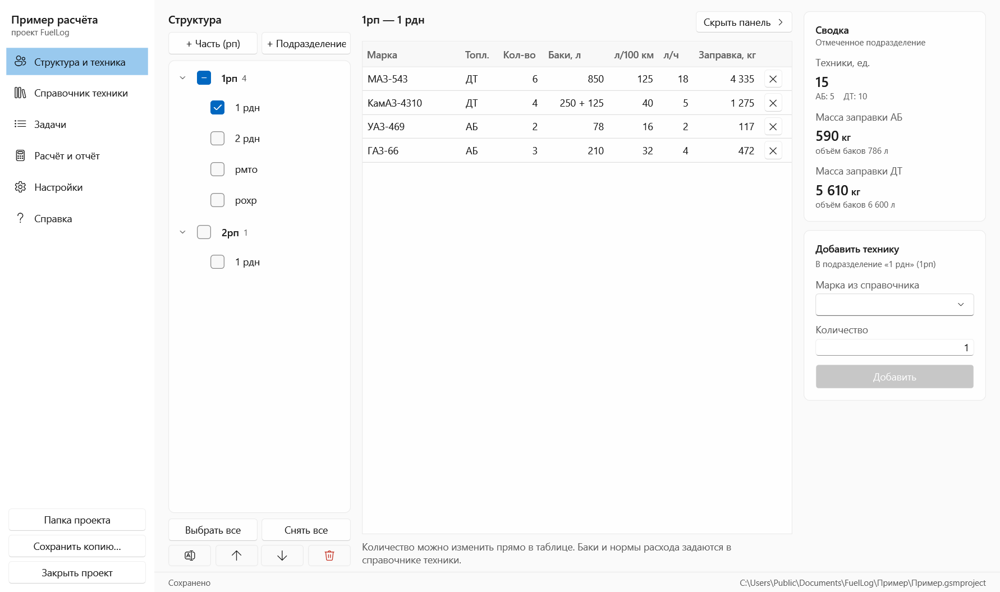
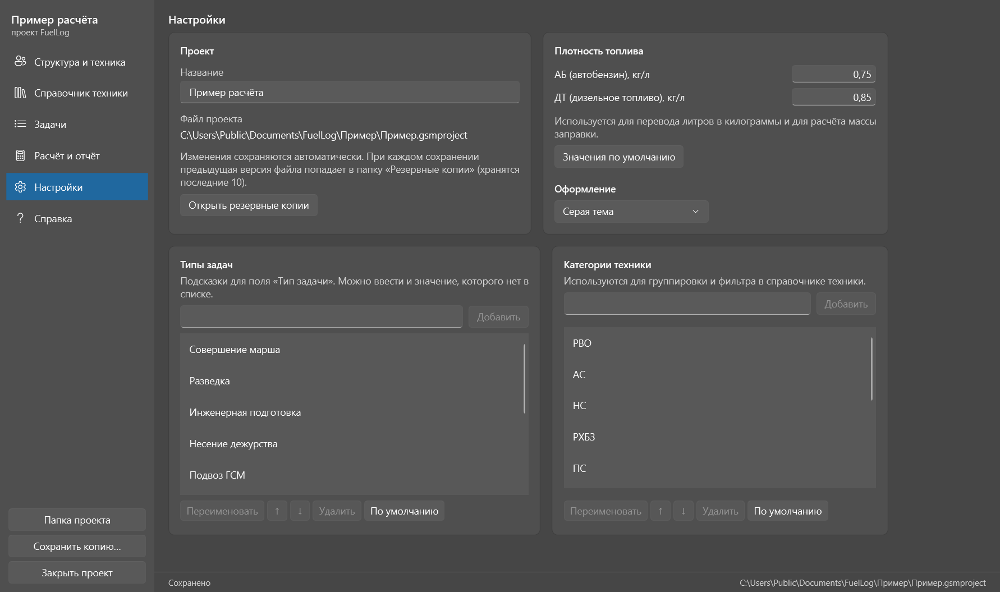

# Руководство пользователя FuelLog 4

FuelLog помогает рассчитать потребность в горюче-смазочных материалах (АБ и ДТ) для задач, которые выполняет
техника подразделений, и сформировать отчёт в Excel по установленной форме.

**Содержание**

1. [Установка](#1-установка)
2. [Первый запуск](#2-первый-запуск)
3. [Как устроена программа](#3-как-устроена-программа)
4. [Справочник техники](#4-справочник-техники)
5. [Структура и техника](#5-структура-и-техника)
6. [Задачи](#6-задачи)
7. [Расчёт и отчёт](#7-расчёт-и-отчёт)
8. [Настройки](#8-настройки)
9. [Методика расчёта](#9-методика-расчёта)
10. [Хранение данных, перенос и резервные копии](#10-хранение-данных-перенос-и-резервные-копии)
11. [Переход с FuelLog 3](#11-переход-с-fuellog-3)
12. [Вопросы и решение проблем](#12-вопросы-и-решение-проблем)

---

## 1. Установка

**Требования:** Windows 10 или 11 (64-разрядная), около 100 МБ на диске. Устанавливать .NET и другие компоненты
не нужно, подключение к сети не требуется.

Скачайте файлы со страницы [Releases](https://github.com/GanJaGIT/fuel-logger3/releases) и выберите один из вариантов.

| Вариант | Файл | Когда подходит |
|---|---|---|
| Установщик | `FuelLog_4.1.0_Setup.exe` | Обычная установка: ярлыки в меню «Пуск» и на рабочем столе, проекты открываются двойным щелчком. Нужны права на установку программ. |
| Переносная версия | `FuelLog_4.1.0_portable.zip` | Без установки: распакуйте архив в любую папку и запустите `FuelLog.exe`. |

**Установщик.** Запустите `FuelLog_4.1.0_Setup.exe` и следуйте шагам мастера. На шаге «Дополнительно» можно
создать ярлык на рабочем столе и связать файлы `*.gsmproject` с программой.

**Переносная версия.** Распакуйте архив целиком. Рядом с `FuelLog.exe` должны лежать пять файлов `*.dll`
и папка `Samples` (демонстрационный пример).

**Компьютеры с Secret Net.** Если включена замкнутая программная среда, администратор безопасности должен
разрешить запуск `FuelLog.exe` и библиотек `*.dll` из папки программы. FuelLog ничего не распаковывает во временные
папки, не обращается к сети и не устанавливает службы.

**Обновление.** Установите новую версию поверх старой. Проекты хранятся отдельно от программы и не затрагиваются.

---

## 2. Первый запуск

После запуска открывается стартовое окно.

- **Создать проект.** Выберите папку и имя файла. Лучше заводить для проекта отдельную папку: рядом с файлом
  появятся папки «Отчёты» и «Резервные копии».
- **Открыть проект.** Открывает файл `*.gsmproject`, в том числе проект FuelLog 3 (см. [раздел 11](#11-переход-с-fuellog-3)).
- **Открыть пример.** Готовый проект с техникой, подразделениями и задачами. Это лучший способ быстро разобраться:
  откройте пример, пройдите по вкладкам и сформируйте отчёт. Пример копируется в `Документы\FuelLog\Пример`,
  поэтому оригинал не портится.
- **Последние проекты.** Щелчок открывает проект, правая кнопка мыши убирает его из списка.

### Быстрый старт за 4 шага

1. **Справочник техники.** Заведите марки техники: топливо, баки, нормы расхода.
2. **Структура и техника.** Создайте воинские части и подразделения и закрепите за подразделениями технику.
3. **Задачи.** Создайте задачу, укажите дату и добавьте технику с километрами марша, часами работы и потерями.
4. **Расчёт и отчёт.** Проверьте предпросмотр и нажмите «Сформировать Excel».

Сохранять ничего не нужно: все изменения записываются автоматически.

---

## 3. Как устроена программа

Слева находится меню с разделами: «Структура и техника», «Справочник техники», «Задачи», «Расчёт и отчёт»,
«Настройки», «Справка». Под меню расположены кнопки:

- **Папка проекта** открывает папку с файлом проекта в Проводнике.
- **Сохранить копию…** сохраняет копию проекта в другой файл, например на флешку.
- **Закрыть проект** возвращает к стартовому окну.

Внизу окна показано состояние сохранения («Сохранено в 14:32:05») и путь к файлу проекта.

**Ввод чисел.** Десятичный разделитель можно вводить и запятой, и точкой. Отрицательные числа не принимаются:
ячейка с ошибкой подсвечивается, а значение не меняется. Ячейки таблиц правятся двойным щелчком или клавишей F2,
Enter подтверждает правку, Esc отменяет её.

---

## 4. Справочник техники

Справочник — это список марок техники с характеристиками, которые используются в расчёте.

| Колонка | Что означает |
|---|---|
| Марка | Название, например «КамАЗ-4310» |
| Топливо | АБ (автобензин) или ДТ (дизельное топливо) |
| Бак осн., л / Бак доп., л | Объём основного и дополнительного баков. Их сумма — полная заправка одной машины |
| Расход, л/100 км | Норма расхода на марше |
| Расход, л/ч | Норма расхода при работе на месте |
| Категория | Для группировки и фильтра (список категорий меняется в «Настройках») |
| Примечание | Произвольный текст |

**Действия:**

- **+ Добавить марку** создаёт строку «Новая марка» и сразу открывает её название для правки.
- **Копировать** создаёт копию выделенной марки, удобно для похожих модификаций.
- **Удалить** удаляет марку. Если она закреплена за подразделениями или используется в задачах, программа покажет,
  где именно, и после подтверждения уберёт её и оттуда.
- **Поиск и фильтр по категории** находятся над таблицей.
- **Экспорт… / Импорт…** сохраняют справочник в файл `*.gsmtemplate` и загружают его на другом ПК.
  При импорте марки с тем же названием обновляются, новые добавляются, а состав подразделений и задачи не меняются.
  Подходят и файлы шаблонов FuelLog 3.

> Нормы и баки хранятся только в справочнике. Если исправить норму, расчёт пересчитается во всех задачах сразу.

---

## 5. Структура и техника

### Дерево структуры (слева)

В левой части — воинские части (рп) с их подразделениями. Новый проект создаётся с типовым набором:
1–4 рп, ртб, трб, поо. Их можно переименовать, удалить или добавить свои.

- **+ Часть (рп)** добавляет воинскую часть.
- **+ Подразделение** добавляет подразделение в выделенную воинскую часть.
  Если в дереве ничего не выделено, оно добавится в часть, подразделения которой отмечены галочками.
- **Кнопки-значки под деревом** переименовывают выделенный элемент (F2), сдвигают его выше или ниже
  и удаляют его (Delete). При удалении подразделения программа предупредит, если его техника задействована в задачах.

### Галочки: какие подразделения показывать

Галочками отмечают подразделения, технику которых нужно увидеть справа:

- **галочка у подразделения** отмечает только это подразделение;
- **галочка у воинской части** отмечает все её подразделения (если отмечена часть из них, квадратик заполнен частично);
- **«Выбрать все» / «Снять все»** отмечают всю структуру или снимают все отметки;
- **двойной щелчок по названию подразделения** оставляет отмеченным только его.

Что показывается в центре:

| Отмечено | Что видно |
|---|---|
| Ничего | Подсказка. Сводка справа считается по всему проекту |
| Одно подразделение | Состав техники. Количество можно менять прямо в таблице, кнопка ✕ убирает марку |
| Несколько подразделений или вся в/ч | Сводная таблица. Переключатель «Сводка: по маркам / по подразделениям» |

### Правая панель

- **Сводка** — количество техники (АБ/ДТ), масса и объём полной заправки по отмеченным подразделениям.
- **Добавить технику** — выберите марку из справочника, укажите количество и нажмите «Добавить».
  Технику можно добавить **только в одно подразделение**. Если отмечено несколько или ни одного, программа
  предупредит об этом. Повторное добавление той же марки увеличивает её количество.

Кнопка **«Скрыть панель»** убирает правую панель, чтобы таблице было просторнее; **«Показать панель»** возвращает её.
Программа запоминает, скрыта панель или нет.

---

## 6. Задачи

### Список задач (слева)

Задачи упорядочены по дате. Галочка слева от задачи означает «учитывать в расчёте».

- **+ Задача** создаёт задачу. Дата берётся из выделенной задачи (или сегодняшняя), тип — первый из списка.
- **Копия** создаёт такую же задачу со всей техникой. Удобно, когда задачи повторяются в разные дни: скопируйте
  и поменяйте дату.
- **Удалить** удаляет задачу (Delete).
- **Отметить все / Снять все** включают или исключают из расчёта все задачи разом.

### Реквизиты задачи

- **Выполняемая задача (как в отчёте)** — название, которое попадёт в колонку «Выполняемая задача» отчёта.
  Пока вы его не изменили, оно повторяет тип задачи.
- **Тип задачи** — выбор из списка (настраивается в «Настройках») или любое своё значение.
- **Дата выполнения** — попадает в колонку «Дата выполнения задачи» и используется для среднесуточного расхода
  и отбора по периоду.

Карточки над таблицей показывают итог задачи: число машин и потери, расход АБ и ДТ в килограммах,
число проблемных строк.

### Добавление техники в задачу

Панель **«Добавить технику в задачу»** внизу:

1. Выберите подразделение в выпадающем списке. Появится закреплённая за ним техника с количеством «В наличии».
2. В правой части укажите **значения для новых строк**: протяжённость марша (км), время работы на месте (ч),
   ожидаемые потери (%).
3. В колонке **«Добавить»** укажите количество машин каждой марки и нажмите **«Добавить отмеченное»**.
   Кнопка **«Добавить всё подразделение»** добавляет всю технику подразделения целиком.

Добавленные строки можно править прямо в таблице: количество, километры, часы, процент потерь.
Расход пересчитывается сразу. Кнопка **«Применить ко всем строкам задачи»** задаёт всем строкам текущие значения
марша, работы и потерь.

**Красная строка** означает, что в задаче задействовано больше машин, чем закреплено за подразделением,
или что подразделение либо марка были удалены. Такие строки также попадают в предупреждения отчёта.

> Одна и та же техника может выполнять несколько задач в один день, например «Разведка» и «Совершение марша».
> Программа это не запрещает. Ограничение «не больше, чем в наличии» действует внутри одной строки задачи.

---

## 7. Расчёт и отчёт

### Предпросмотр

Таблица повторяет лист «Расчёт» будущего Excel-файла: строки задач, итоги подразделений, итоги воинских частей
и общий итог.

- **Только задачи, отмеченные «в расчёт»** — учитываются только задачи с галочкой.
- **За период с … по …** — дополнительно ограничить расчёт датами. По умолчанию период охватывает все задачи.

Если что-то не так (не хватает техники, у подразделения нулевая масса заправки, строка ссылается на удалённую марку),
над таблицей появляется жёлтый блок **«Проверьте данные»** со списком замечаний.

### Формирование Excel

Нажмите **«Сформировать Excel»**. Файл `Расчёт ГСМ ГГГГ-ММ-ДД ЧЧ-ММ-СС.xlsx` сохраняется в папку «Отчёты» рядом
с проектом и сразу открывается. Если есть предупреждения, программа сначала покажет их и спросит, продолжать ли.

Состав файла:

| Лист | Содержимое |
|---|---|
| **Расчёт** | Форма из образца: воинская часть, подразделение, задача, дата; расход АБ/ДТ в кг и заправках; масса заправки; среднесуточный расход. Итоговые строки выделены серым. Шапка повторяется на каждой печатной странице, лист печатается по ширине на A4 альбомной ориентации |
| **Детализация** | Каждая марка в каждой задаче: количество, потери, километры, часы, нормы, расход на марш, на работу и потери, итог в литрах и килограммах. С автофильтром |
| **Параметры** | Проект, дата формирования, плотности, методика расчёта и предупреждения |

Вкладка **«Сформированные отчёты»** содержит список созданных файлов с кнопками «Открыть», «В папке» и «Удалить».

---

## 8. Настройки

- **Проект:** название, путь к файлу, кнопка «Открыть резервные копии».
- **Плотность топлива:** АБ и ДТ в кг/л (по умолчанию 0,75 и 0,85). Используется для перевода литров
  в килограммы и для расчёта массы заправки. Задайте значения, принятые в вашей организации.
- **Оформление:** «Как в Windows», светлая, серая или тёмная тема.
- **Типы задач** и **категории техники:** списки-подсказки. Можно добавлять, переименовывать, менять порядок,
  удалять и возвращать стандартный набор. На уже созданные задачи и марки это не влияет.

---

## 9. Методика расчёта

Расчёт выполняется для каждой строки задачи (марка одного подразделения) и затем суммируется.

| Величина | Формула |
|---|---|
| Потеряно, ед. | `кол-во × потери % / 100`, округление до целого (0,5 — вверх) |
| Работают, ед. | `кол-во − потеряно` |
| Расход, л | `работают × (км / 100 × норма л/100 км + ч × норма л/ч) + потеряно × (бак осн. + бак доп.)` |
| Расход, кг | `расход, л × плотность` (АБ или ДТ) |
| Масса заправки, кг | `Σ кол-во × (бак осн. + бак доп.) × плотность` по всей технике уровня |
| Заправки | `расход, кг / масса заправки` того же уровня |
| Среднесуточный расход | `заправки / число дней`, в которые выполнялись задачи |

**Уровни массы заправки:**

- для строки задачи и итога подразделения — вся техника подразделения;
- для итога воинской части — вся техника части, **включая подразделения без задач**;
- для общего итога — сумма по воинским частям, попавшим в отчёт.

**Потери.** Потерянные машины задачу не выполняют: расход на марш и работу для них не считается,
а топливо из их баков списывается полностью.

**Пример (из демонстрационного проекта).** 2рп, 1 рдн, задача «Совершение марша»: МАЗ-543 × 6, марш 150 км,
норма 125 л/100 км, бак 850 л, потери 17 %, плотность ДТ 0,85.

| Шаг | Расчёт | Результат |
|---|---|---|
| Потеряно | 6 × 17 / 100 = 1,02 → 1 | 1 машина, работают 5 |
| Марш | 5 × 150 / 100 × 125 | 937,5 л |
| Потери | 1 × 850 | 850,0 л |
| Итого | 1 787,5 л × 0,85 | 1 519,38 кг |
| Масса заправки 1 рдн | (6 × 850 + 4 × 375) × 0,85 | 5 610 кг |
| Заправки | 1 519,38 / 5 610 | 0,27 |

---

## 10. Хранение данных, перенос и резервные копии

- **Проект хранится в одном файле `*.gsmproject`.** Это текстовый JSON, база данных не нужна.
- **Автосохранение.** Изменения записываются через секунду после правки; Ctrl+S сохраняет немедленно.
  Запись надёжная: сначала во временный файл, затем подмена, поэтому сбой питания не повредит проект.
- **Резервные копии.** Перед каждым сохранением предыдущая версия файла копируется в папку «Резервные копии»
  (хранятся последние 10, не чаще одной в минуту). Чтобы откатиться, закройте проект и откройте нужную копию
  или скопируйте её на место основного файла.
- **Перенос на другой ПК.** Скопируйте файл проекта (и при желании папку «Отчёты»), например через
  «Сохранить копию…» на съёмный носитель. Справочник техники можно перенести отдельно через «Экспорт…».
- **Один проект в двух окнах.** Если файл изменили в другой копии программы, при сохранении появится вопрос,
  перезаписывать ли его.
- **Настройки программы** (тема, список последних проектов) хранятся в `%APPDATA%\FuelLog\settings.json`
  и к проекту не относятся.

---

## 11. Переход с FuelLog 3

Откройте старый файл `*.gsmproject` через «Открыть проект». Программа:

- перенесёт справочник техники (из папки `Settings\templates`), структуру подразделений с техникой
  (из `Data\units.json`) и настройки: плотности и типы задач;
- сохранит исходный файл рядом как `*.gsmproject.v3.bak` и запишет проект в новом формате;
- покажет, сколько марок и подразделений перенесено.

Задачи FuelLog 3 не сохранял, поэтому их нужно создать заново.

> Обратите внимание на плотности: в FuelLog 3 по умолчанию стояли АБ 0,80 и ДТ 0,75. После импорта проверьте их
> в «Настройках».

---

## 12. Вопросы и решение проблем

**Кнопка «Добавить» в «Структуре» неактивна.** Выберите марку из справочника и укажите количество больше нуля.

**Появляется «Добавлять технику можно только в одно подразделение».** Оставьте отмеченным одно подразделение.
Быстрее всего — двойным щелчком по его названию.

**В задаче нет кнопок добавления или они неактивны.** Выберите подразделение в выпадающем списке панели
«Добавить технику в задачу». Если список пуст, создайте подразделения на вкладке «Структура и техника».

**Строка задачи красная.** Задействовано больше машин, чем закреплено за подразделением, или подразделение
либо марка удалены. Исправьте количество или состав подразделения.

**В отчёте предупреждение «масса заправки равна нулю».** У подразделения есть расход, но в его составе нет
техники с этим видом топлива или у марок не указаны баки. Проверьте состав подразделения и справочник.

**Отчёт пустой («Нет данных для расчёта»).** Отметьте задачи галочкой «в расчёт», добавьте в них технику
и проверьте фильтр по периоду.

**Не удаётся удалить файл отчёта.** Скорее всего, он открыт в Excel. Закройте его и повторите.

**Программа сообщила об ошибке.** Данные проекта сохраняются автоматически. Подробности записаны в журнал
`%APPDATA%\FuelLog\errors.log`; приложите его, когда сообщаете о проблеме.

**Клавиши.**

| Клавиши | Действие |
|---|---|
| Ctrl+N | Новый проект |
| Ctrl+O | Открыть проект |
| Ctrl+S | Сохранить немедленно |
| F1 | Справка |
| F2 | Правка ячейки, переименование в дереве |
| Delete | Удалить выбранное |
| Enter / Esc | Подтвердить / отменить правку ячейки |
